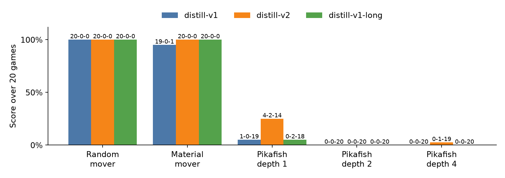

# cc-lite

[](https://github.com/hskl18/cc-lite/actions/workflows/tests.yml)

`cc-lite` is a compact AlphaZero-style research workbench for Chinese Chess (Xiangqi): rules, a PyTorch policy-value network, PUCT MCTS, self-play, training, and an evaluation harness.
It exists because small game-playing experiments are easy to over-read, so every reported game result comes from raw games that a validator replays move by move.

**Status: research baseline, v0.4.0.**
The first distilled checkpoint clearly beats the scripted baselines and the debug checkpoint, but it and two successors lost 170 of 180 games to Pikafish at depths 1 to 4, and the repository makes no engine-strength or absolute Elo claim.

## Headline result

The distilled checkpoint is a 128-channel, 8-block network trained in 11 minutes on one RTX 5070 Ti from 848,307 Fairy-Stockfish depth-10 labels; the debug checkpoint is a 64-channel, 4-block network trained on one 8-ply self-play game.
Each played the two scripted opponents with the same evaluation config (50-simulation MCTS, 20 seeded games, colors alternating, 400-ply cap, CPU), on different machines: the distilled one on an AMD Ryzen 7 9800X3D, the debug one on an Apple M3 Pro.

| Opponent | Distilled (`distill-v1`) | Debug checkpoint (`baseline-v1`) |
| --- | --- | --- |
| Uniform random mover | 20 wins, 0 draws, 0 losses, 0 capped | 11 wins, 0 draws, 1 loss, 8 capped |
| One-ply greedy material mover | 19 wins, 0 draws, 1 loss, 0 capped | 0 wins, 2 draws, 15 losses, 3 capped |

In a separate paired comparison on the pinned opening suite (seeds 1, 7, and 19, 200 simulations on the GPU, both colors from every opening), the distilled checkpoint scored 43 wins, 1 draw, and 0 losses against the debug checkpoint over 22 complete pairs.
Its score rate was 0.989, with a 95 percent paired-bootstrap interval of 0.966 to 1.0, and the sequential rule stopped at 22 pairs with a superiority decision.
The references are scripted movers and an almost untrained network, so these results show that distillation works end to end, not that the network plays well.

Against a real engine it does not.



*Wins-draws-losses from the committed bundles. The scripted movers used 50 simulations on CPU and Pikafish games used 200 on the GPU; `uv run scripts/plot_results.py` redraws it.*

Three attempts to improve on `distill-v1` have not demonstrated a gain.
[`distill-v2`](evidence/distill-v2), with fewer random moves and smoother value targets, lost their paired comparison 14-1-33.
[`distill-v1-long`](evidence/distill-v1-long), the same data trained for 18 epochs instead of 6, lost its paired comparison 17-2-29.
[Four generations of self-play](evidence/selfplay-v1) from `distill-v1` scored 18-4-26 against it, an interval of 0.302 to 0.521 that does not show an improvement.

The validator rebuilds each count from the raw games, with the same command for every bundle in `evidence/distill-v1`, `evidence/distill-v2`, and `evidence/distill-v1-long`; the generation-4 bundles are a release asset described in [`evidence/selfplay-v1`](evidence/selfplay-v1):

```bash
python -m eval.evidence validate --run-dir evidence/distill-v1/random
python -m eval.evidence validate --run-dir evidence/distill-v1/material
python -m eval.evidence validate --run-dir evidence/distill-v1/vs-debug
```

## Run it

```bash
python3 -m venv .venv && source .venv/bin/activate && pip install -e ".[dev]" && ./scripts/generate_baseline_evidence.sh
```

The script replays all 40 baseline games on CPU and validates both bundles; it took about 11 minutes on an Apple M3 Pro.
`pytest` runs the full test suite in under half a minute.

## Non-goals

- A strong engine: use [Pikafish](https://github.com/official-pikafish/Pikafish), [Px0](https://github.com/official-pikafish/px0), or [Fairy-Stockfish](https://fairy-stockfish.github.io/) for analysis.
- Strength or Elo claims from the committed debug checkpoint, from capped games, or from any bundle that fails `python -m eval.evidence validate`.
- Tournament-rule compliance: results follow the narrower [CC-Lite Research Adjudication Profile 1](docs/rules-profile.md).
- Large-scale training: the configs target one laptop or one consumer GPU.

The practical path to strength is distillation from engine labels first, then AlphaZero-lite self-play, which v0.3.0 and v0.4.0 have tried without yet reaching Pikafish at depth 2, as laid out in [`docs/industry-roadmap.md`](docs/industry-roadmap.md).
The hard parts, the decisions behind them, and the failures that shaped them are in [DESIGN.md](DESIGN.md).

## Evidence

Each bundle holds every move, seed, color, start and final FEN, termination reason, the config and checkpoint hashes, the exact command, the source commit, and the environment.
Terminal wins, draws, and losses are kept apart from games truncated at `max_plies`; material at a cutoff is diagnostic metadata and never becomes a result or a self-play label.
CI validates every committed evaluation bundle on each push.

- [`evidence/distill-v1`](evidence/distill-v1): the distilled checkpoint, the records of its data and training, and its six evaluation bundles; its [README](evidence/distill-v1/README.md) has the commands, and the 4 MB and 8 MB compressed positions and labels are attached to the v0.3.0 release.
- [`evidence/distill-v2`](evidence/distill-v2): a second distilled checkpoint with six evaluation bundles; its data is attached to the v0.4.0 release.
- [`evidence/distill-v1-long`](evidence/distill-v1-long): `distill-v1`'s data trained for 18 epochs instead of 6, with six evaluation bundles; its paired and Pikafish games ran on a Kaggle T4.
- [`evidence/selfplay-v1`](evidence/selfplay-v1): the record of four self-play generations; the final checkpoint and its evaluation games are attached to the v0.4.0 release, so CI does not validate those.
- [`evidence/heldout-v1`](evidence/heldout-v1): 24,728 labeled positions no distilled checkpoint trained on, with each checkpoint's agreement report; those reports replay no games.
- [`evidence/baseline-v1`](evidence/baseline-v1): the debug checkpoint's floor in the table above, regenerated by `./scripts/generate_baseline_evidence.sh` with [`configs/baseline_cpu.yaml`](configs/baseline_cpu.yaml).
  A rerun of the first two games on the same machine reproduced the recorded moves exactly; other hardware or library versions can break floating-point ties differently, so the committed games stay the source of truth.
- [`evidence/debug-v1`](evidence/debug-v1): a two-game-per-opponent pipeline smoke artifact with a 20-ply cap, regenerated by `./scripts/generate_debug_evidence.sh`.
  All four games hit the cap, so it supports no result.
  It also versions the 6.8 MB debug checkpoint that both bundles evaluate, so a fresh clone can verify the exact bytes.

[`evidence/distill-v1/vs-debug`](evidence/distill-v1/vs-debug) is the first committed checkpoint-versus-checkpoint comparison; any further one must pass every gate in [`docs/evaluation-protocol.md`](docs/evaluation-protocol.md).

## Architecture

- `src/xiangqi/`: board representation, legal move generation, FEN parsing, board encoding, and pinned adjudication behavior.
- `src/data/`: validated ICCS/UCCI record ingestion, provenance, deduplication, split fingerprints, and rejection reports.
- `src/model/`: compact residual CNN policy-value network and checkpoint helpers.
- `src/mcts/`: PUCT-style MCTS using legal policy masking and value backup.
- `src/train/`: bounded supervised experiments, optional engine distillation labels, and self-play generation.
- `src/eval/`: random and material baselines, checkpoint matches, paired opening evaluation, statistical reporting, and FEN analysis.
- `configs/`: reproducible presets for MacBook, GPU, and quick debug runs.
- `scripts/`: common smoke, training, and evaluation commands.
- `tests/`: rules, encoding, MCTS, and training smoke coverage.

## Move Encoding

The policy vocabulary is fixed at `90 x 90 = 8100` indices:

```text
policy_index = from_square * 90 + to_square
```

Squares are row-major from Black's home rank to Red's home rank.
Files are `a-i`, rows are `0-9`, so Black's left rook starts on `a0` and Red's left rook starts on `a9`.

The model always emits 8100 logits.
MCTS masks illegal moves with the current board's legal move list.
The training metrics do not mask, so `legal_move_accuracy` reports how often the network's unmasked top move is legal.

## Model

The baseline model is a small residual CNN:

- Input: 16 planes over a `10 x 9` board.
- Piece planes: 7 red piece types and 7 black piece types.
- Extra planes: side to move and current-side-in-check.
- Policy head: logits over 8100 from-to moves.
- Value head: scalar in `[-1, 1]` from the side-to-move perspective.

Presets:

- `tiny`: 4 residual blocks, 64 channels.
- `small`: 6 residual blocks, 96 channels by default.

## Setup

```bash
python3 -m venv .venv
source .venv/bin/activate
pip install -e ".[dev]"
```

If PyTorch is already installed for your platform, the editable install is usually enough.
For CUDA machines, install the PyTorch wheel matching your driver/CUDA version first, then run the editable install.

## Supported Machines

`cc-lite` is meant to be portable across normal development machines:

- macOS MacBook: uses Apple MPS when PyTorch exposes it, otherwise CPU.
- Linux PC: works on CPU and uses CUDA automatically when a compatible NVIDIA GPU and CUDA PyTorch build are installed.
- Windows PC: works on CPU or CUDA through PyTorch.
  The shell scripts in `scripts/` are Bash scripts, so run them from Git Bash or WSL, or use the explicit `python -m ...` commands below from PowerShell.
- Consumer NVIDIA GPU: use `configs/gpu_small.yaml` as the first non-debug profile.

The `research_debug` config is the safest first run on any machine.
It is intentionally tiny and only proves that rules, MCTS, training, checkpointing, and evaluation are wired correctly.

## Smoke Training On MacBook

Runs one very short self-play game, trains one checkpoint, and evaluates against random:

```bash
./scripts/smoke_macbook.sh
```

Equivalent explicit commands:

```bash
export PYTHONPATH=src
python -m train.self_play \
  --config configs/research_debug.yaml \
  --output runs/research_debug/selfplay.jsonl \
  --train \
  --checkpoint-out runs/research_debug/checkpoints/selfplay.pt

python -m eval.evaluate \
  --config configs/research_debug.yaml \
  --checkpoint runs/research_debug/checkpoints/selfplay.pt \
  --opponent random \
  --output-dir runs/research_debug/evaluation-random
```

Expected runtime is seconds to a couple of minutes depending on CPU/MPS behavior.
Memory use should stay well under normal laptop limits because the debug run uses very few plies and simulations.

## Smoke Training On Windows Or Linux PC

From PowerShell on Windows, use the module commands directly:

```powershell
$env:PYTHONPATH = "src"
python -m train.self_play `
  --config configs/research_debug.yaml `
  --output runs/research_debug/selfplay.jsonl `
  --train `
  --checkpoint-out runs/research_debug/checkpoints/selfplay.pt

python -m eval.evaluate `
  --config configs/research_debug.yaml `
  --checkpoint runs/research_debug/checkpoints/selfplay.pt `
  --opponent random `
  --output-dir runs/research_debug/evaluation-random
```

From Linux, WSL, or Git Bash, either run `./scripts/smoke_macbook.sh` or the Bash commands shown in the MacBook smoke section.
The script name says MacBook because it uses the tiny debug profile, not because it is macOS-only.

## MacBook Tiny Run

```bash
./scripts/train_macbook_tiny.sh
```

This uses the tiny 4-block model, 50 MCTS simulations, small batches, and `fp32`.
Expect this to be slow compared with real engines because it is meant for reproducibility and pipeline validation.

## NVIDIA GPU Small Run

```bash
./scripts/train_gpu_small.sh
```

This uses the small model, 200 simulations, batch size 64, and CUDA mixed precision when CUDA is available.
On an RTX-class GPU, memory should remain modest because the network and replay set are small.
Increase games, replay size, and simulations only after the debug run is stable.

Windows users can run the same workflow from Git Bash/WSL, or translate it to PowerShell:

```powershell
$env:PYTHONPATH = "src"
python -m train.self_play `
  --config configs/gpu_small.yaml `
  --output runs/gpu_small/selfplay.jsonl `
  --train `
  --checkpoint-out runs/gpu_small/checkpoints/latest.pt

python -m eval.evaluate `
  --config configs/gpu_small.yaml `
  --checkpoint runs/gpu_small/checkpoints/latest.pt `
  --opponent material `
  --output-dir runs/gpu_small/evaluation-material
```

## Validated Record Ingestion

The practical path is to bootstrap from game records before self-play.
The ingestion CLI accepts documented ICCS/UCCI JSONL records and requires a separate provenance file with source and license information.

```bash
python -m data.ingest \
  --input path/to/games.jsonl \
  --provenance path/to/provenance.json \
  --output-dir runs/ingested/my-dataset \
  --validation-fraction 0.1 \
  --split-seed research-v1
```

The output contains normalized games, deterministic training and validation splits, a rejection report, and a hash-linked manifest.
See [`docs/data-ingestion.md`](docs/data-ingestion.md) for the exact input schema and license boundary.

## Bounded Supervised Bootstrap

The `bootstrap_debug` profile caps the number of records and writes a checkpoint, raw metrics, and a manifest with exact data, config, and checkpoint hashes.
The bundle is published to its final output directory only after its evidence validator passes.

```bash
python -m train.experiment run \
  --config configs/bootstrap_debug.yaml \
  --data runs/ingested/my-dataset/train.jsonl \
  --output-dir runs/bootstrap/debug

python -m train.experiment validate \
  --output-dir runs/bootstrap/debug
```

## Optional Pikafish / Engine Distillation

If you have a UCI/UCCI-compatible engine such as Pikafish, cache labels first:

```bash
export PYTHONPATH=src
python -m train.distill_engine \
  --engine ./pikafish \
  --positions data/raw/positions.jsonl \
  --output runs/distill_labels.jsonl \
  --depth 4 \
  --threads 1 \
  --hash-mb 16
```

The distillation manifest records the exact engine executable hash, any file arguments, positions hash, protocol, depth, thread count, hash size, timeout, value mapping, policy target, command, and generated-label hash.
Engine labels are cached so experiments are reproducible and do not depend on querying the engine during training.

By default the policy target is the engine's best move alone.
With `--multipv K` above 1, the engine reports up to K best moves, and the policy target becomes a softmax over their scores, `exp((score - best) / T)`, where `--policy-temperature` sets `T` in centipawns (default 100).
The lines come from the last depth with an exact score for line 1; reports marked `lowerbound` or `upperbound` are skipped.
If that report is inconsistent, because line 1 is not the move the engine played, a move appears twice, or a move is illegal under the rules profile, the target falls back to the best move alone.
An illegal best move still stops the run, as before.
Mate scores count as plus or minus 100,000 centipawns, so two mating moves get equal weight whatever their distance.
Each line's move and score are kept under `multipv`, so another temperature needs no new search.
The value target comes from line 1's exact score, and is 0 if the engine reported none.

## Evaluation And Analysis

Evaluate against random or material-count baselines:

```bash
./scripts/evaluate_checkpoint.sh configs/macbook_tiny.yaml runs/macbook_tiny/checkpoints/latest.pt random
./scripts/evaluate_checkpoint.sh configs/macbook_tiny.yaml runs/macbook_tiny/checkpoints/latest.pt material
```

Evaluate against a low-depth UCI/UCCI engine such as Pikafish, pinning its separate network file so the evidence records exactly which one played:

```bash
./scripts/evaluate_engine.sh \
  configs/engine_eval.yaml \
  runs/macbook_tiny/checkpoints/latest.pt \
  ./pikafish \
  ./pikafish.nnue \
  4
```

Equivalent explicit command:

```bash
export PYTHONPATH=src
python -m eval.evaluate \
  --config configs/engine_eval.yaml \
  --checkpoint runs/macbook_tiny/checkpoints/latest.pt \
  --opponent engine \
  --engine-command ./pikafish \
  --engine-eval-file ./pikafish.nnue \
  --engine-depth 4 \
  --output-dir runs/macbook_tiny/evaluation-pikafish-depth-4
```

Engine binaries and generated engine-label datasets should stay outside Git; the exception is a small fixed evaluation set committed as evidence, such as [`evidence/heldout-v1`](evidence/heldout-v1).
The `.gitignore` covers `runs/`, checkpoint files, and common ML artifacts.

Run the pinned opening suite with paired colors and multiple seeds:

```bash
python -m eval.head_to_head \
  --config configs/paired_eval.yaml \
  --checkpoint-a path/to/candidate.pt \
  --checkpoint-b path/to/reference.pt \
  --opening-suite configs/openings/paired-v1.json \
  --seeds 1,7,19 \
  --min-pairs 8 \
  --max-pairs 24 \
  --output-dir evidence/my-paired-run
```

The paired report includes per-seed results, paired bootstrap intervals, an uncertainty-bounded Elo difference estimate, draw and truncation rates, and a conservative sequential decision.
See [`docs/evaluation-protocol.md`](docs/evaluation-protocol.md) before interpreting any result.

Analyze a position:

```bash
export PYTHONPATH=src
python -m eval.analyze \
  --config configs/research_debug.yaml \
  --checkpoint runs/research_debug/checkpoints/selfplay.pt \
  --fen "rheakaehr/9/1c5c1/p1p1p1p1p/9/9/P1P1P1P1P/1C5C1/9/RHEAKAEHR r"
```

## Metrics

The current scripts log:

- policy loss
- value loss
- legal move accuracy
- target move accuracy
- result score vs random/material baseline
- MCTS nodes/s
- checkpoint metadata with config and train stats
- per-game moves, seeds, colors, FENs, and termination reasons
- terminal results separately from max-plies truncation diagnostics
- evidence manifests with config, checkpoint, source, command, and environment provenance
- paired-color score and draw intervals from complete opening pairs
- Elo difference estimates with uncertainty and explicit method labels
- sequential stopping decisions that exclude capped and incomplete pairs

## Tests

```bash
pytest
```

The test suite covers the pinned rules profile, randomized legal-game reversibility, ingestion, move encoding, MCTS, bounded training, paired evaluation, statistics, evidence reconstruction, and package metadata.

## Known Limitations

- The supported adjudication profile is intentionally narrower than full tournament long-check and long-chase rules.
- The ingestion pipeline supports a documented JSONL ICCS/UCCI move-record envelope, not binary XQF, CBL, or every historical notation.
- Engine compatibility still requires per-engine validation even though executable and option provenance is recorded.
- Pure random-initialized self-play remains a research baseline, not the practical strength path.
- The paired opening suite is small and designed for reproducible local comparison, not comprehensive opening coverage.
- The committed debug evidence has two games per opponent and supports no strength conclusion.
- The baseline evidence starts every game from the standard position, uses one checkpoint and one simulation budget, and comes from 20 games per opponent; it is a floor, not a strength estimate.
- Throughput values are environment-specific diagnostics and are not gated or presented as stable benchmarks.

## Next Research Steps

1. Add separately tested XQF and CBL converters into the validated JSONL ingestion boundary.
2. Build a larger replay buffer with checkpoint metadata and train/eval dashboards.
3. Find out why four self-play generations showed no gain over `distill-v1`, and train on more games per generation; distillation labels come from Fairy-Stockfish because of Pikafish's weight license (see `DESIGN.md`).
4. Add repetition and check-state history planes for models that need access to adjudication context.
5. Run ablations over channels, blocks, simulations, replay size, and data source, changing one thing at a time; `distill-v2` changed two.
6. Speed up self-play generation, which takes far longer than training on its output.
